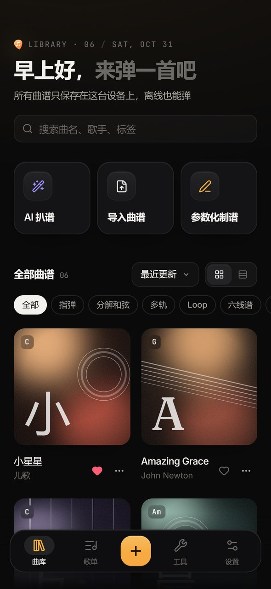
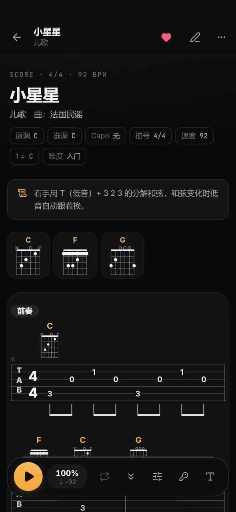
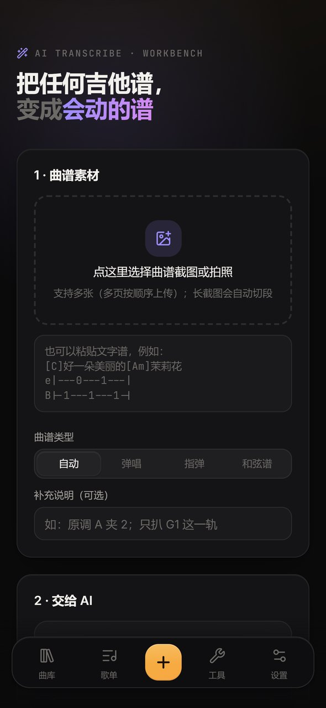
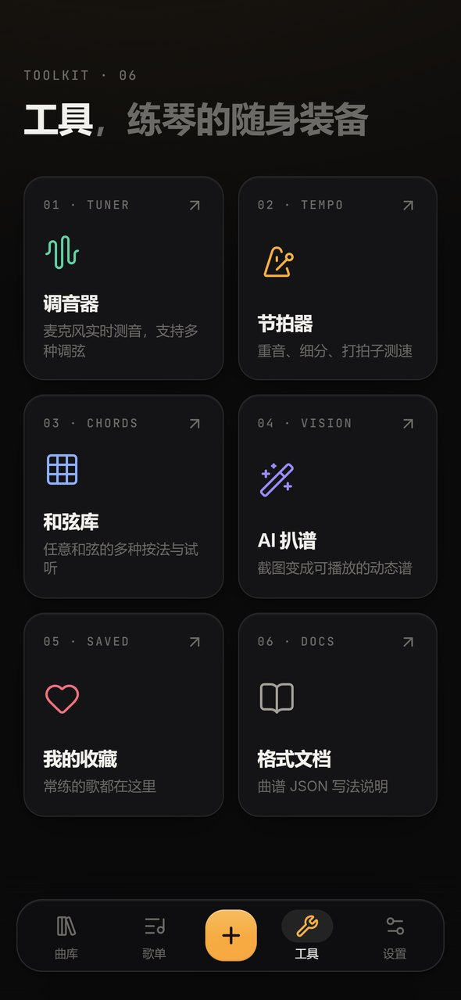
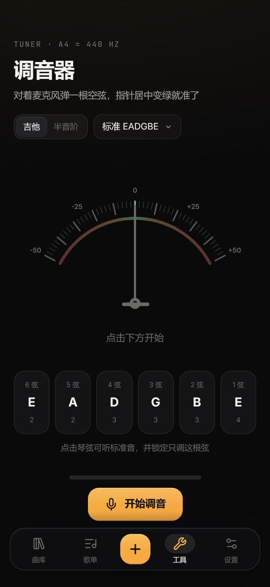
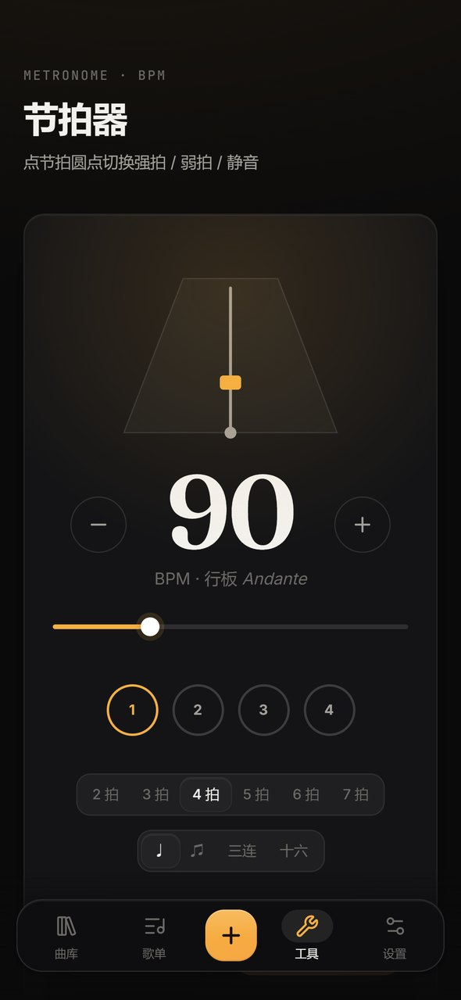
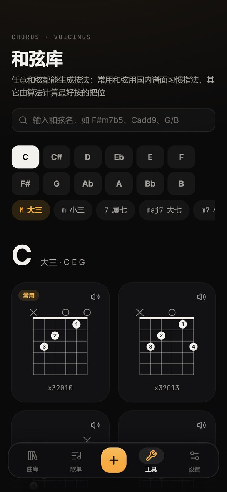
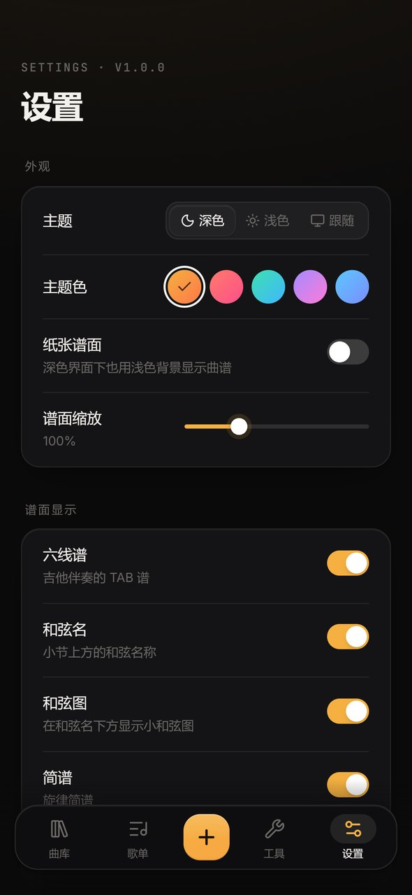
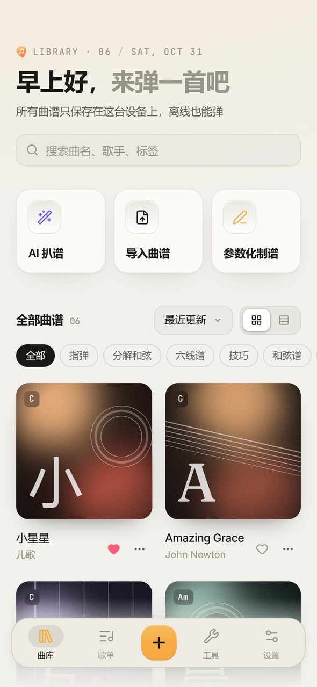
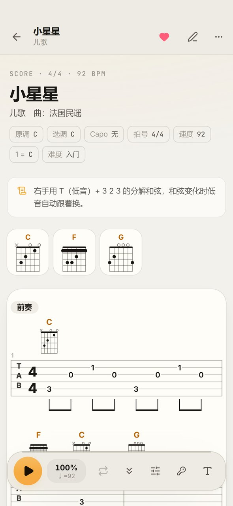

<div align="center">


# 没谱了

**本地优先的吉他谱 App** · 参数化制谱 · AI 扒谱 · 多轨播放 · 变调 · 调音器

[](../../releases/latest)


[](LICENSE)

[**⬇ 下载安卓 APK**](../../releases/latest) · [快速开始](#快速开始) · [曲谱格式](#曲谱格式简要)

</div>

<br />

<p align="center">
  
  
  
  
  
</p>
<p align="center">
  
  
  
  
  
</p>

<br />

所有曲谱都由你自己创建、保存在本机，不依赖在线曲库，离线可用。核心是一套**参数化的曲谱 JSON 格式**：大多数弹唱伴奏只需要写「和弦 + 节奏型」，六线谱自动生成；所以很适合让 AI 把谱子截图扒成 JSON 再直接导入，也能直接导入 Guitar Pro 文件和网上复制来的文字谱。

## 下载安装

- **安卓**：到 [Releases](../../releases/latest) 下载 `meipule-x.y.z.apk`，传到手机上安装（需要允许「安装未知来源应用」）。覆盖安装不会丢失曲库数据。
- **网页 / 桌面**：按下面的[快速开始](#快速开始)自己运行或部署；网页版是 PWA，可以「添加到主屏幕」当 App 用。

## 功能

- **动态谱面**：六线谱 + 和弦图 + 简谱 + 多段歌词，自动排版、自动换行；也支持和弦歌词谱（`[C]好一朵[Am]茉莉花`）
- **多轨**：多把吉他（各自的调弦、变调夹）+ 鼓/拍琴板分轨记谱，谱面分层显示；混音里可以单独隐藏、静音、独奏某一轨；Loop 循环用 `%4` 复制
- **播放**：物理建模合成的吉他音色（分解、扫弦、切音、击勾滑音）、旋律引导音、节拍器、预备拍；播放光标跟随，谱面自动滚动
- **练习**：变速（30%–160%）、AB 循环（点选小节，Shift 多选）、无伴奏自动滚动、屏幕常亮
- **变调**：选调（换一组好按的指法）+ 变调夹，自动保持原调；和弦、节奏型、手写六线谱一起移调
- **制谱编辑器**：可视化编辑段落和小节、节奏型网格编辑器、常用节奏型预设、JSON 代码编辑、实时预览与格式校验、撤销/重做
- **导入现成的谱**：Guitar Pro（.gp3/.gp4/.gp5/.gpx/.gp）和 MusicXML 文件，包括多轨、鼓轨、反复和跳房子；网页、App 里复制的文字谱（和弦写在歌词上方、[C] 内嵌和弦、ChordPro、文字六线谱）。全部在本地转换，不需要 AI
- **AI 扒谱**：上传截图/拍照或粘贴文字谱，复制提示词到任意 AI（Claude、ChatGPT、Kimi、豆包、DeepSeek…），或填 API Key 一键直连（Claude 或任意 OpenAI 兼容接口），流式输出，自动校验，一键「让 AI 修正问题」
- **工具**：调音器（麦克风，多种调弦）、节拍器（重音、细分、打拍测速）、和弦库（任意和弦的多种按法与试听）
- **曲库**：搜索、标签、收藏、继续练习、歌单（拖拽排序、演出时上一首/下一首）、命令面板（Ctrl+K）
- **数据**：IndexedDB 本地存储，JSON 导入导出、整库备份恢复，拖拽 JSON 到窗口即可导入，拖入图片直接开始 AI 扒谱
- **PWA**：可安装到手机主屏幕/桌面，离线可用；深色/浅色主题、5 种主题色、纸张谱面

## 快速开始

需要 Node.js 20+。

```bash
npm install
npm run dev        # 开发模式，浏览器打开 http://localhost:5173
npm run build      # 生成 dist/ 静态文件（含 PWA）
npm run preview    # 预览打包结果
npm test           # 单元测试（解析器、编译器、和弦生成、调音算法）
```

Windows 下也可以直接双击 `启动没谱了.bat`（首次会自动安装依赖；代码有改动时会自动重新打包，打开的网页也会自动更新到新版本）。

**在手机上用**：`npm run dev` 后用手机浏览器访问终端里显示的局域网地址即可。注意浏览器只允许在 HTTPS 或 localhost 下使用麦克风，所以手机上的调音器需要部署到 HTTPS 站点后使用。`dist/` 是纯静态文件，可以直接放到 GitHub Pages、Cloudflare Pages、Vercel 或任意 Nginx 上，然后「添加到主屏幕」当 App 用。

## 安卓 App（APK）

项目里的 `android/` 是用 [Capacitor](https://capacitorjs.com/) 生成的原生安卓工程，网页代码打包进 App，离线可用。App 版额外支持：返回键、全面屏/沉浸模式、练琴时屏幕常亮、导出文件走系统分享面板，以及调用国内 AI 接口不受跨域限制。

```bash
npm run android:apk    # 打包并编译调试版 APK → apk/没谱了-1.0.0.apk
npm run android:open   # 同步最新网页代码，并用 Android Studio 打开 android/ 工程
npm run android:sync   # 只同步网页代码到安卓工程（改完网页后在 Android Studio 里直接运行）
npm run android:live   # 热更新预览：App 直接加载电脑上的 npm run dev，改代码手机上即时刷新
```

脚本会自动使用 Android Studio 自带的 JDK（`D:\Android Studio\jbr`）和 `%LOCALAPPDATA%\Android\Sdk`；装在别处时可设置环境变量 `ANDROID_STUDIO_PATH`、`ANDROID_HOME`。

**在 Android Studio 里预览手机效果**
1. `npm run android:open`（或在 Android Studio 里 File → Open，选择项目下的 `android` 文件夹），等 Gradle 同步完成
2. 右侧 Device Manager → 新建虚拟设备（如 Pixel 8，选一个系统镜像下载），或用 USB 连接开启了「USB 调试」的真机
3. 点工具栏的 ▶ Run，App 就会在模拟器/手机上运行
4. 想边改边看：先 `npm run dev`，再 `npm run android:live`，然后在 Android Studio 里点 ▶；之后改代码 App 会自动刷新。结束后运行 `npm run android:sync` 恢复正常模式

**图标/启动页**：图形定义在 `src/lib/brand.ts`。`node scripts/icons.mjs` 重新生成网页/PWA 图标，`npm run android:assets` 重新生成安卓启动图标和启动页（这两个脚本需要 Node.js 22.18+，以及本机安装的 Microsoft Edge）。

**正式签名版**：调试版 APK 已可直接安装使用。若要发布或长期使用，可在 Android Studio 里用 Build → Generate Signed App Bundle / APK 生成自己签名的 release 版（请保管好 keystore，以后升级需要同一个签名）。

## 曲谱格式（简要）

完整说明在 App 内「格式文档」页面，也可以直接复制给 AI。最小示例：

```json
{
  "title": "小星星",
  "key": "C",
  "capo": 0,
  "tempo": 92,
  "time": "4/4",
  "patterns": { "分解": "T 3 2 3 1 3 2 3", "扫弦": "D - D U - U D U" },
  "sections": [
    { "name": "前奏", "pattern": "分解", "progression": "C | F C | G | C" },
    {
      "name": "主歌", "pattern": "分解", "repeat": 2,
      "measures": [
        { "chord": "C", "melody": "1 1 5 5", "lyrics": ["一闪一闪", "挂在天上"] },
        { "chords": "F C", "melody": "6 6 5 -", "lyrics": ["亮晶晶", "放光明"] }
      ]
    },
    { "name": "间奏", "measures": [{ "chord": "C", "tab": "5:3/8 3:0 2:1 3:0 4:2+1:0 3:0 2:1h 2:3" }] }
  ]
}
```

- **节奏型**：`T` 和弦根音低音弦、`T2` 交替低音、`1-6` 弦号（品位取当前和弦指法）、`D/U` 下扫/上扫、`X` 切音、`-` 延音、`r` 休止，`+` 同时弹，`/8` 指定时值
- **精确六线谱**：`弦:品/时值`，技巧后缀 `h p s b ~ * >`
- **简谱**：`1-7`、`0` 休止、`1'` 高八度、`5,` 低八度、`#4`、`/8`、`-` 延长一拍
- **和弦歌词谱**：段落用 `"lines": ["[C]好一朵美丽的[Am]茉莉花"]`
- **多轨（meipule/2）**：顶层 `"tracks": [{"id": "G1"}, {"id": "G2", "capo": 5}, {"id": "kick", "type": "drums"}]`，小节里 `"tracks": {"G2": "1:5/4 1:4/8 1:2/8 1:0/2", "kick": "K/4 K K K"}`；鼓轨记号 `K S H O C T X`；`"%4"` 表示和 4 小节之前一样

## 快捷键（谱面页）

`空格` 播放/暂停 · `←/→` 上/下一小节 · `L` 循环所选小节 · `M` 节拍器 · `+/-` 缩放 · `Esc` 取消选择 · `Ctrl+K` 搜索

## 项目结构

```
src/
  lib/music/        乐理、和弦解析/移调、和弦指法库与指法生成器
  lib/notation/     曲谱格式：类型、记法解析、编译（参数化展开/移调/校验）、播放时间线、格式文档与 AI 提示词
  lib/audio/        音频引擎（Karplus-Strong 拨弦合成）、播放调度器、调音器音高检测
  lib/db.ts         IndexedDB（Dexie）存储、备份
  lib/ai.ts         AI 扒谱（Claude 官方 SDK / OpenAI 兼容接口）
  components/score/ 谱面排版引擎与 SVG 渲染
  pages/            曲库、谱面、编辑器、AI 扒谱、歌单、调音器、节拍器、和弦库、设置、文档
src/samples/        内置示例曲谱（公版曲目与原创练习曲）
```

## 技术栈

React 19 · TypeScript · Vite · Tailwind CSS 4 · Motion · Dexie（IndexedDB）· CodeMirror 6 · alphaTab（Guitar Pro 解析）· Capacitor 8（安卓）· Web Audio（Karplus-Strong 拨弦合成）

## 关于 API Key

AI 直连时，API Key 只保存在本机浏览器的 localStorage 中，请求由浏览器直接发往你填写的服务商。不想填 Key 的话，用「复制提示词」把提示词和图片发给任意 AI 对话即可，效果一样。

## 许可证

[MIT](LICENSE) © 2026 jie8190
